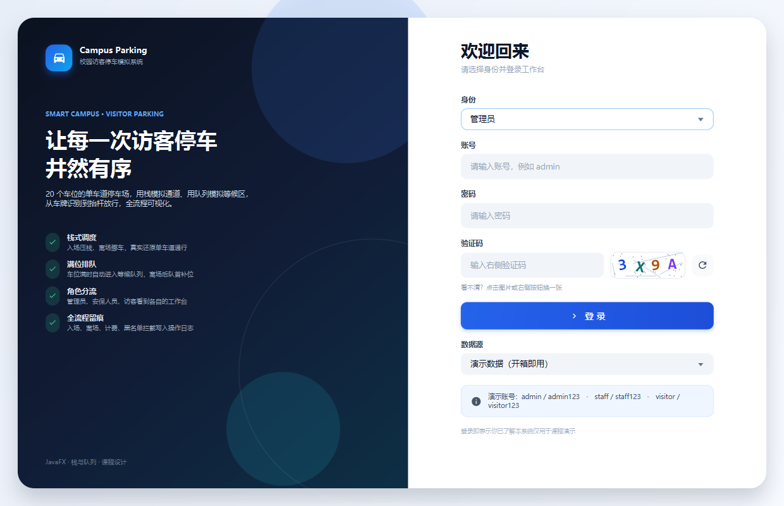
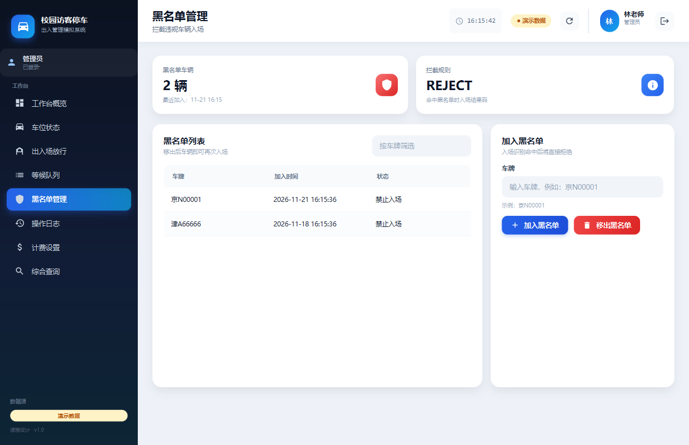
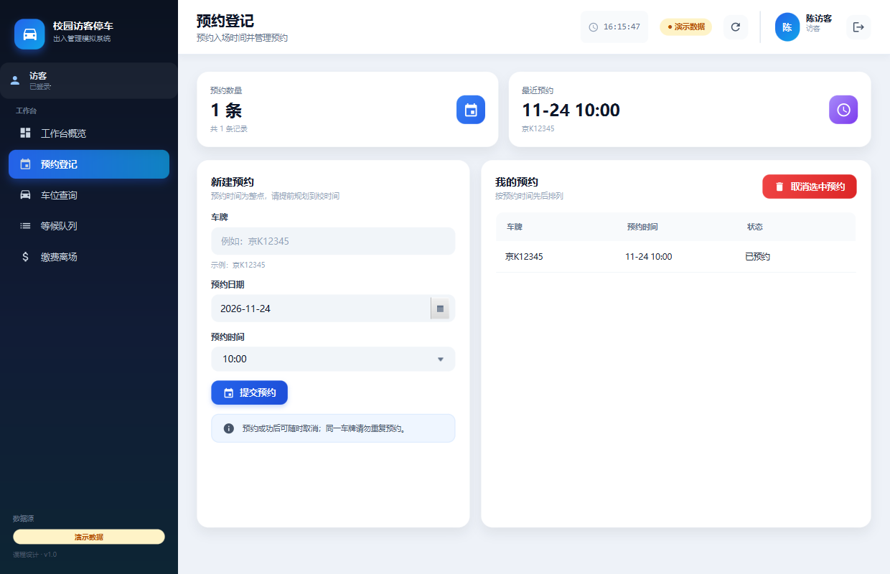

# 校园访客停车模拟系统

某高校访客停车场的课程设计项目：20 个单车道车位、满位排队、黑名单拦截、分角色管理。
停车场通道用**栈**模拟，等候区用**队列**模拟，数据用 Jackson 持久化为 JSON。

本项目当前状态：

- **业务层**（`model` / `service` / `util` / `datastructure`）由队友实现，仍有部分方法体为空。
- **界面层**（`ui`）已完成，并内置一套**演示数据源**，不依赖业务层即可独立运行、演示和答辩。
- 队友完成业务层后，按 [GUI 接入说明](src/Doc/GUI接入说明.md) 切换数据源即可接入，**界面代码不需要修改**。

## 快速开始

环境要求：JDK 17+、Maven 3.8+。

```bash
cd CampusVisitorParking
mvn clean javafx:run
```

首次运行默认使用**演示数据**，在登录页直接使用下面的账号：

| 角色 | 账号 | 密码 | 登录后可见 |
| --- | --- | --- | --- |
| 管理员 | `admin` | `admin123` | 工作台、车位状态、出入场放行、等候队列、黑名单、操作日志、计费设置、综合查询 |
| 安保人员 | `staff` | `staff123` | 工作台、访客登记、出入场放行、车位状态、等候队列 |
| 访客 | `visitor` | `visitor123` | 工作台、预约登记、车位查询、等候队列、缴费离场 |

> 演示数据全部在内存中，重启后恢复初始状态；不会读写 JSON 文件。

### 免安装双击启动（已打包）

项目里的 `dist/` 已包含独立 JRE 17、JavaFX 和程序，**不需要安装 JDK 或 Maven**：

- 双击桌面上的 **「校园访客停车系统」**；
- 或双击 `dist/启动停车系统.vbs`；
- 如果启动失败，双击 `dist/调试启动.bat`，窗口里会显示具体错误。

`dist/` 约 120 MB，已加入 `.gitignore`，不会提交到 Git；请不要删除或拆分该目录。
修改源码后需要重新生成 `dist/`（重新编译并替换 `dist/app/parking-app.jar`）。

## 接入真实业务层

登录页的「数据源」下拉框选择 **真实业务层** 即可，无需重启。

也可以在启动前指定默认数据源：

```bash
mvn javafx:run -Dparking.backend=service
# 或者
set PARKING_BACKEND=service
mvn javafx:run
```

在 IDE 中运行时，给 `com.smartparking.main.main` 添加 VM 参数 `-Dparking.backend=service`。

业务层尚未完成时，真实模式会出现「登录失败 / 入场未生效」等提示，但界面不会崩溃。
具体接入步骤见 **[src/Doc/GUI接入说明.md](src/Doc/GUI接入说明.md)**。

## 界面预览

| 登录页 | 管理员工作台 |
| --- | --- |
|  |  |

| 车位状态 | 出入场放行 |
| --- | --- |
|  |  |

| 黑名单管理 | 预约登记 |
| --- | --- |
|  |  |

## 界面功能

- **登录页**：三种身份、账号密码、4 位字母数字混合验证码（不区分大小写、点击换一张）、数据源切换。
- **角色分流**：不同角色进入不同导航菜单，越权页面不可见。
- **工作台**：在场 / 空余 / 排队 / 费率指标，车位占用条，道闸动画，最近操作与队列预览。
- **车位状态**：20 个车位平面图、入口 / 最深处标识、道闸红绿灯、等候队列表。
- **出入场放行**：车牌识别入场、黑名单拦截、满位自动排队、费用试算、缴费离场、抬杆 3 秒后自动落杆。
- **等候队列**：FIFO 排位、等待时长、队首补位规则说明。
- **黑名单管理**：加入 / 移出 / 搜索，入场命中直接拒绝。
- **操作日志**：按操作人、关键字、结果筛选。
- **计费设置**：单位费率调整、公式说明、费用试算。
- **综合查询**：按车牌汇总在场、排队、黑名单、预估费用。
- **访客登记**：安保人员登记姓名、电话、车牌、来访事由。
- **预约登记 / 缴费离场**：访客预约整点时间、取消预约、查询费用并缴费。

## 技术结构

```
com.smartparking
├── main/              程序入口（JavaFX Application）
├── ui/                ← 本仓库负责的界面层
│   ├── backend/       数据源契约 ParkingBackend + DemoBackend + ServiceBackend 适配器
│   ├── component/     卡片、道闸动画、验证码、Toast、图标等复用组件
│   ├── util/          格式化与车牌校验
│   ├── view/          登录页、主框架、各业务页面
│   ├── AppContext     会话、数据源、页面切换
│   ├── MainShell      角色导航与顶栏
│   └── ParkingApp     JavaFX 启动类
├── model/             实体类（队友）
├── service/           业务逻辑（队友）
├── datastructure/     自定义栈与队列（队友）
└── util/              JSON 持久化与日志（队友）
```

界面层只依赖 `ParkingBackend` 接口和 DTO。唯一直接接触 `model/service/datastructure` 的文件是
`ui/backend/ServiceBackend.java`，队友改业务签名时只需改这一个适配器。

## 测试

```bash
mvn test
```

`DemoBackendTest` 覆盖登录、入场、满位排队、离场计费、队首补位、黑名单、预约、访客登记、
综合查询、费率修改，以及真实业务层适配器的容错行为。

## 文档

- [GUI 接入说明（给队友）](src/Doc/GUI接入说明.md)
- [软件需求规格说明书](../srs.md)
- [开发交接](../分工.md)
